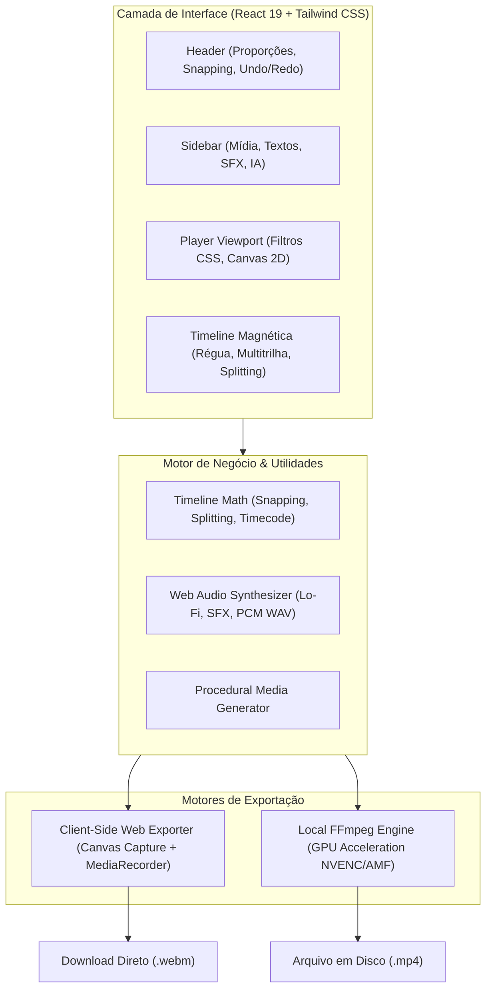

# GardenCut 🌿✂️

[](https://github.com/FelipeGardenghiDev/garden-cut/actions/workflows/ci.yml)


> Editor de vídeos não-linear moderno e de alta performance no estilo CapCut, desenvolvido com React 19, Web Audio API procedural, renderização client-side via HTML5 Canvas + MediaRecorder e suporte desktop via Rust / Tauri 2.0.

---

## 🏗️ Arquitetura do Sistema



---

## 🚀 Funcionalidades Principais

* **Interface Dark Moderna & Responsiva:**
  * Proporções de aspecto dinâmicas: **16:9** (YouTube), **9:16** (TikTok, Reels, Shorts), **1:1** (Instagram).
  * Timeline Magnética com atração inteligente por snapping e guias visuais.
  * Histórico completo de Undo / Redo (`Ctrl+Z` / `Ctrl+Y`).
* **Síntese de Áudio Procedural (Web Audio API):**
  * **Trilha Lo-Fi Beat**: Sintetizador procedural embutido com acordes (Fmaj7, Em7, Dm7, Cmaj7), bateria e baixo.
  * **Efeitos Sonoros Reais (SFX)**: *Whoosh*, *Ding de Sucesso*, *Pop Click*, *Bass Drop 808*.
  * Conversão de `AudioBuffer` em PCM 16-bit WAV válido via DataView.
* **Player em Tempo Real com Multi-Camadas:**
  * Transformações visuais em tempo real: **Escala**, **Posição X/Y**, **Rotação** e **Opacidade**.
  * Filtros de Cor via Canvas e CSS: *Cinematic*, *Vibrant*, *Vintage*, *Cyberpunk*, *Preto & Branco* e *Blur*.
  * Timecode milimétrico (`MM:SS:FF`) e controles por atalhos de teclado.
* **Timeline Não-Linear com Snapping & Split:**
  * Trilhas separadas para **Texto/Legendas**, **Vídeo Principal** e **Áudio/SFX**.
  * Ferramenta de **Corte / Split (`Ctrl + B`)** calculando matematicamente os novos `trimStart` e `trimEnd`.
* **Exportação Dupla com Download Real no Navegador:**
  * **Web MediaRecorder (Client-Side)**: Grava diretamente os frames renderizados e áudio no cliente, gerando arquivos para download imediato sem precisar de nenhum servidor Node ou FFmpeg.
  * **FFmpeg Nativo**: Suporte para aceleração local por hardware quando executado em ambiente com Node/Tauri.

---

## 🛠️ Stack Tecnológica

| Camada | Tecnologia |
| :--- | :--- |
| **Framework UI** | React 19 + TypeScript + Vite 8 |
| **Estilização** | Tailwind CSS v4 |
| **Áudio** | Web Audio API (OfflineAudioContext + OscillatorNode + BiquadFilter) |
| **Renderização Web** | HTML5 Canvas + MediaRecorder API (`video/webm;codecs=vp9,opus`) |
| **Desktop Nativo** | Rust + Tauri 2.0 (`src-tauri`) |
| **Testes Unitários** | Vitest (19 testes passando com 100% de precisão) |
| **Linter & Qualidade** | Oxlint (0 avisos, 0 erros em 17 arquivos) |
| **CI/CD** | GitHub Actions Pipeline automatizada |

---

## 🧪 Testes Automatizados & Qualidade de Código

O projeto conta com suíte de testes unitários automatizados validando toda a matemática de corte, snapping, timecode e encoding binário WAV:

```bash
# Rodar todos os testes unitários com Vitest
npm run test

# Rodar testes em modo watch interativo
npm run test:watch

# Rodar análise estática com Oxlint
npm run lint

# Checagem de tipagem estrita com TypeScript
npx tsc -b --noEmit

# Compilação do bundle de produção
npm run build
```

---

## 💻 Como Rodar Localmente

```bash
# 1. Clonar repositório
git clone https://github.com/FelipeGardenghiDev/garden-cut.git
cd garden-cut

# 2. Instalar dependências
npm install

# 3. Iniciar servidor de desenvolvimento
npm run dev
```

Abra no navegador em: **`http://localhost:5173/`**

### 📦 Compilar como App Desktop Nativo (.exe com Rust / Tauri)

```bash
# Executar em modo desenvolvimento nativo
npm run tauri dev

# Gerar instalador desktop (.exe / .msi)
npm run tauri build
```

---

## ⌨️ Atalhos do Teclado

| Tecla | Ação |
| :--- | :--- |
| **Barra de Espaço** | Play / Pause |
| **Ctrl + B** | Dividir / Cortar clipe na agulha (*Split*) |
| **Delete / Backspace** | Excluir clipe selecionado |
| **J / L** | Voltar 1s / Avançar 1s |
| **Ctrl + Z / Ctrl + Y** | Desfazer / Refazer |
