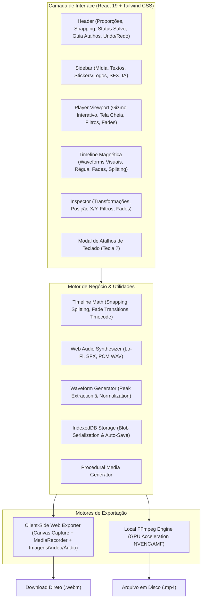

# GardenCut 🌿✂️

[](https://github.com/FelipeGardenghiDev/garden-cut/actions/workflows/ci.yml)


> Editor de vídeos não-linear moderno e de alta performance no estilo CapCut, desenvolvido com React 19, Web Audio API procedural, renderização client-side via HTML5 Canvas + MediaRecorder, persistência local via IndexedDB e manipulação direta com Gizmo no Canvas.

---

## 🏗️ Arquitetura do Sistema



---

## 🚀 Funcionalidades Principais

* **Drag & Drop Nativo do Sistema Operacional (OS):**
  * Arraste arquivos de vídeo (`.mp4`, `.webm`), áudio (`.mp3`, `.wav`) e imagens (`.png`, `.jpg`, `.svg`) direto do seu desktop ou explorador de arquivos para a janela do editor.
  * Overlay visual dinâmico com drop-zone animada e processamento automático de waveforms para faixas de áudio.
* **Manipulação Direta no Canvas (*Bounding Box / Gizmo Interativo*):**
  * Selecione qualquer clipe (vídeo, imagem ou texto) para interagir diretamente no player.
  * Mova livremente elementos pela tela arrastando o corpo do gizmo (atualização contínua de `posX` e `posY`).
  * 4 alças de canto interativas para redimensionamento de escala (*Zoom*) milimétrico direto no canvas.
* **Modo Tela Cheia & Guia Completo de Atalhos (`?`):**
  * Alternância instantânea para modo **Tela Cheia** via botão no player ou tecla de atalho **`F`**.
  * Modal interativo com todos os atalhos de teclado categorizados acessível pelo botão de ajuda no Header ou pressionando a tecla **`?`** a qualquer momento.
* **Camada de Imagens, Logos & Stickers Visuais (`image`):**
  * Suporte nativo a clipes do tipo imagem (PNG, JPG, SVG, WebP) com biblioteca de adesivos rápidos (*Logo GardenCut*, *Selo Ao Vivo*, *Inscreva-se*, *Verificado*).
  * Transformações visuais completas (escala, rotação, opacidade, posição X/Y), filtros de cor e fades de entrada/saída.
  * Renderização e pré-carregamento sincronizado na exportação WebM via Canvas.
* **Persistência Local Completa (IndexedDB):**
  * Salvamento automático com debounce contínuo (`800ms`) diretamente no IndexedDB do navegador.
  * Serialização e restauração binária de mídias Blob: ao recarregar a página (`F5`), seu projeto continua intacto.
  * Indicador de salvamento em tempo real no Header (*"Salvo"* / *"Salvando..."*) e opção de *"Novo Projeto"*.
* **Formas de Onda de Áudio Visuais (*Audio Waveforms*):**
  * Renderização de picos de amplitude sonora (*waveforms*) ao longo dos clipes na timeline no estilo Premiere/CapCut.
  * Extração analítica de picos de `AudioBuffer` decodificados e geração procedural de picos para beats e SFX.
* **Transições Suaves de Fade In & Fade Out:**
  * Controles dedicados no painel Inspector para configurar Fade In e Fade Out (0s a 3s) com presets rápidos.
  * Marcadores triangulares visuais (`◢` e `◣`) nos cantos superiores dos clipes na timeline.
  * Interpolação suave aplicada em tempo real na opacidade de vídeo, volume de áudio e overlays de legendas (tanto no player quanto na exportação final).
* **Interface Dark Moderna & Responsiva:**
  * Proporções de aspecto dinâmicas: **16:9** (YouTube), **9:16** (TikTok, Reels, Shorts), **1:1** (Instagram).
  * Timeline Magnética com atração inteligente por snapping e guias visuais.
  * Histórico completo de Undo / Redo (`Ctrl+Z` / `Ctrl+Y`).
* **Síntese de Áudio Procedural (Web Audio API):**
  * **Trilha Lo-Fi Beat**: Sintetizador procedural embutido com acordes (Fmaj7, Em7, Dm7, Cmaj7), bateria e baixo.
  * **Efeitos Sonoros Reais (SFX)**: *Whoosh*, *Ding de Sucesso*, *Pop Click*, *Bass Drop 808*.
  * Conversão de `AudioBuffer` em PCM 16-bit WAV válido via DataView.
* **Exportação Dupla com Download Real no Navegador:**
  * **Web MediaRecorder (Client-Side)**: Grava diretamente os frames renderizados e áudio no cliente, gerando arquivos WebM para download imediato sem precisar de nenhum servidor Node ou FFmpeg.
  * **FFmpeg Nativo**: Suporte para aceleração local por hardware quando executado em ambiente com Node/Tauri.

---

## 🛠️ Stack Tecnológica

| Camada | Tecnologia |
| :--- | :--- |
| **Framework UI** | React 19 + TypeScript + Vite 8 |
| **Estilização** | Tailwind CSS v4 |
| **Interatividade** | Direct Canvas Gizmo (Bounding Box) + Drag & Drop Nativo |
| **Persistência** | IndexedDB Nativo (`GardenCut_DB`) com serialização de Blobs |
| **Áudio & Waveforms** | Web Audio API + OfflineAudioContext + Peak Analysis |
| **Renderização Web** | HTML5 Canvas + MediaRecorder API (`video/webm;codecs=vp9,opus`) |
| **Desktop Nativo** | Rust + Tauri 2.0 (`src-tauri`) |
| **Testes Unitários** | Vitest (28 testes passando com 100% de precisão) |
| **Linter & Qualidade** | Oxlint (0 avisos, 0 erros em 21 arquivos) |
| **CI/CD** | GitHub Actions Pipeline automatizada |

---

## 🧪 Testes Automatizados & Qualidade de Código

O projeto conta com suíte de testes unitários automatizados validando toda a matemática de corte, snapping, timecode e encoding binário WAV:

```bash
# Rodar todos os testes unitários com Vitest
npm run test

# Rodar testes em modo watch interativo
npm run test:watch

# Rodar análise estática com Oxlint
npm run lint

# Checagem de tipagem estrita com TypeScript
npx tsc -b --noEmit

# Compilação do bundle de produção
npm run build
```

---

## 💻 Como Rodar Localmente

```bash
# 1. Clonar repositório
git clone https://github.com/FelipeGardenghiDev/garden-cut.git
cd garden-cut

# 2. Instalar dependências
npm install

# 3. Iniciar servidor de desenvolvimento
npm run dev
```

Abra no navegador em: **`http://localhost:5173/`**

### 📦 Compilar como App Desktop Nativo (.exe com Rust / Tauri)

```bash
# Executar em modo desenvolvimento nativo
npm run tauri dev

# Gerar instalador desktop (.exe / .msi)
npm run tauri build
```

---

## ⌨️ Atalhos do Teclado

| Tecla | Ação |
| :--- | :--- |
| **Barra de Espaço** | Play / Pause |
| **Ctrl + B** | Dividir / Cortar clipe na agulha (*Split*) |
| **Delete / Backspace** | Excluir clipe selecionado |
| **J / L** | Voltar 1s / Avançar 1s |
| **Ctrl + Z / Ctrl + Y** | Desfazer / Refazer |
