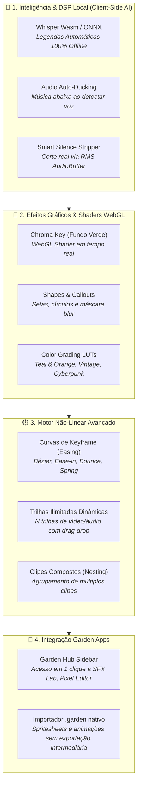

# 🚀 GardenCut — Roadmap Estratégico de Evolução (Pós-V1)

> **Documento de Engenharia & Visão de Produto para o GardenCut**, consolidando o estado atual das funcionalidades entregues e estabelecendo as próximas frentes técnicas de desenvolvimento.

---

## 📊 Estado Atual da V1 (Concluído & Validado)

Todas as funcionalidades abaixo foram implementadas, cobertas por testes automatizados e integradas na branch `main`:

* ✅ **Gravador Nativo de Tela e Webcam (`ScreenRecorderModal.tsx`):** Captura ao vivo da tela inteira, janelas ou câmera/microfone via `MediaStream` e `MediaRecorder` diretamente no navegador, com preview e injeção automática na timeline.
* ✅ **Equalizador & DSP de Áudio Real-Time:** Filtros paramétricos biquad (*Bass Boost 808*, *Vocal Presence*, *Lo-Fi*) com visualizador de espectro de frequência animado reativo à reprodução.
* ✅ **Transições Visuais Cinematográficas:** *Cross-dissolve*, *Slide Left*, *Fade to Black* e *Flash White* computados frame a frame pelo motor matemático.
* ✅ **Picture-in-Picture & Trilha Overlay (`track-overlay`):** Suporte a sobreposição de webcams e vídeos secundários com manipulador Gizmo interativo no canvas.
* ✅ **Keyframes Temporais Paramétricos:** Interpolação linear contínua (Lerp) de Escala, Posição X/Y, Rotação e Opacidade com marcadores em diamante (`◆`) nos clipes.
* ✅ **Exportador de GIF Animado (`gif-exporter.ts`):** Codificação local via `gifenc` com quantização de paleta para 256 cores e download direto.
* ✅ **PWA & Instalação Offline:** Web App Manifest e metatags para execução como aplicativo nativo independente de conexão.
* ✅ **Confiabilidade:** **36 testes unitários no Vitest passando** e **0 avisos/erros no Oxlint**.

---

## 🎯 Próximas Frentes de Desenvolvimento

---

### 1. 🧠 Inteligência & DSP de Áudio Local (*Client-Side AI*)

* **Transcrição de Voz com Whisper WebAssembly / ONNX Runtime Web:**
  * Substituir o mock atual de legendas por inferência neural direta no navegador via `@xenova/transformers` (modelo Whisper Tiny/Base quantizado em INT8).
  * Gera legendas palavra-por-palavra precisas em português e inglês sem depender de servidores e com zero custo de API.
* **Auto-Ducking de Áudio (Sidechain Compression):**
  * Quando houver voz sendo reproduzida na trilha de vídeo ou narração, o volume da trilha musical (`track-audio`) reduz suavemente de 100% para 25% (-12 dB) e retorna gradualmente quando a fala cessa.
* **Corte Real de Silêncio Baseado em Decibéis:**
  * Algoritmo que lê as amostras do `AudioBuffer` e fatia a timeline automaticamente nos trechos com sinal inferior a -35 dB por mais de 0.5s.

---

### 2. 🎨 Efeitos Gráficos & Shaders WebGL

* **Chroma Key (Remoção de Fundo Verde) em Tempo Real:**
  * Shader de fragmento WebGL para eliminar panos de fundo verde de webcams e gameplay com ajustes de *Tolerance*, *Smoothness* e *Spill Suppression*.
* **Anotações Dinâmicas (Shapes & Callouts):**
  * Ferramenta de adicionar setas animadas, retângulos de destaque e máscaras de censura/pixelização (*Blur Mask*) para ocultar senhas, dados bancários ou rostos em tutoriais.
* **Filtros Cinematográficos e Presets LUT:**
  * Color grading acessível em 1 clique: *Teal & Orange*, *Cyberpunk Neon*, *P&B Noir*, *Vintage VHS* com granulação procedural.

---

### 3. ⏱️ Motor de Timeline & Experiência Profissional

* **Curvas de Bézier e Easing para Keyframes:**
  * Substituição da interpolação puramente linear por curvas aceleradas (*Ease-In-Out*, *Cubic*, *Elastic*), gerando transições suaves de zoom e enquadramento.
* **Trilhas Ilimitadas Dinâmicas:**
  * Capacidade de adicionar quantas trilhas de vídeo e áudio forem necessárias com reordenação vertical (arrastar trilha para cima/baixo).
* **Clipes Compostos (*Compound Clips / Nesting*):**
  * Capacidade de selecionar um grupo de clipes (vídeo + legenda + efeito sonoro) e colapsá-los em um único clipe reutilizável.

---

### 4. 🌿 Interoperabilidade com o Ecossistema Garden Apps & GC Studio

* **Aba "Garden Studio" na Sidebar:**
  * Seletor rápido para importar criações dos outros aplicativos da suíte:
    * 🎵 **[Garden SFX Lab](https://github.com/FelipeGardenghiDev/garden-sfx-lab):** Gerar efeitos sonoros e soltá-los na timeline com 1 clique.
    * 🎨 **[Garden Pixel Editor](https://github.com/FelipeGardenghiDev/garden-pixel-editor):** Importar sprites animados direto na trilha de sobreposição.
    * 📱 **[Garden Auto-Framer](https://github.com/FelipeGardenghiDev/garden-auto-framer):** Importar cortes verticais já reenquadrados.
    * 📝 **[Garden Subtitle](https://github.com/FelipeGardenghiDev/garden-subtitle):** Injetar legendas cinéticas customizadas.
